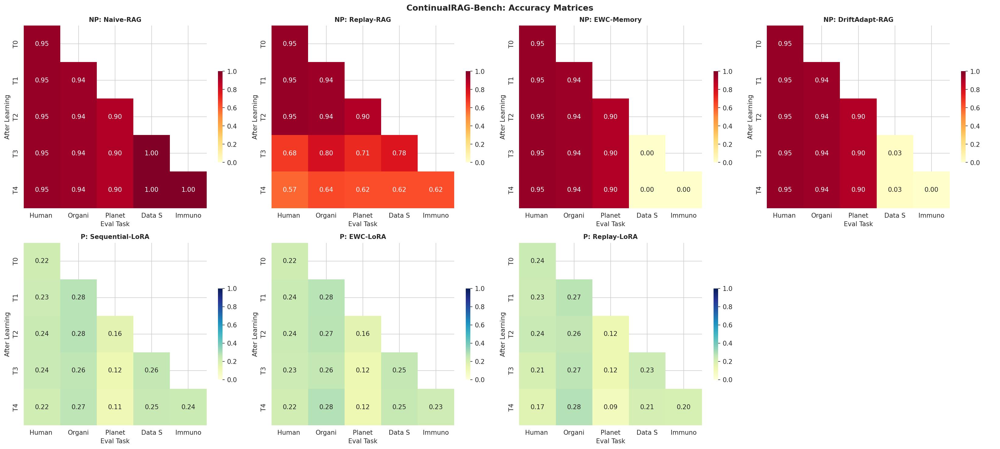

# ContinualRAG-Bench

**Benchmarking non-parametric and parametric continual learning for memory-augmented retrieval agents under distribution drift.**

[](https://colab.research.google.com/github/blck-iris/continualrag-bench/blob/main/continualrag_bench.ipynb)
[](https://pytorch.org)
[](LICENSE)

ContinualRAG-Bench measures how retrieval-augmented agents **forget** as new knowledge arrives. Five knowledge domains arrive one after another. After each domain, every method is evaluated on all domains seen so far, so the benchmark reports both how well a method learns new information and how much it keeps of old information.

> **Status: preliminary.** Results come from a single seeded run (seed 42) on a small synthetic corpus. See [Limitations](#limitations) before drawing conclusions.

## Motivation

Agents with persistent memory must learn from new interactions without erasing what they already know. Two families of approaches address this:

- **Non-parametric** memory keeps knowledge in an external store (for example, a vector index) and retrieves it at inference time.
- **Parametric** memory stores knowledge in model weights, updated through fine-tuning.

This benchmark runs both families through the same sequential protocol and reports the same continual-learning metrics for each.

## What's benchmarked

Five domains arrive sequentially:

**Human Anatomy → Organic Chemistry → Planetary Science → Data Structures → Immunology**

Each domain has 40 documents and 80 question-answer pairs. The corpus is synthetic and template-generated (see Limitations).

**Non-parametric (retrieval / memory)**

- **Naive-RAG**: append-only FAISS vector store.
- **Replay-RAG**: reservoir-sampled bounded memory.
- **EWC-Memory**: retention weighted by Fisher importance.
- **DriftAdapt-RAG**: heteroscedastic sliding-window drift detection with importance-based consolidation.

**Parametric (LoRA on Flan-T5-Small)**

- **Sequential-LoRA**: naive sequential fine-tuning.
- **EWC-LoRA**: Fisher-regularized fine-tuning.
- **Replay-LoRA**: experience-replay buffer.

Embeddings use `all-MiniLM-L6-v2`. The generator is `google/flan-t5-small` with LoRA (r=8, α=16).

## Metrics

Each method produces an accuracy matrix `R[i, j]`, where `R[i, j]` is performance on domain `j` after learning domain `i`.

- **Avg Accuracy**: mean of the final row, `R[n-1, :]`.
- **BWT (Backward Transfer)**: mean change on earlier domains from when each was learned to the end. Negative values indicate forgetting.
- **FWT (Forward Transfer)**: performance on a domain before it is trained on.
- **Forgetting**: mean drop from each domain's best accuracy to its final accuracy.
- **95% CI**: percentile bootstrap over 1,000 resamples.

For parametric methods the score is token-level F1. For non-parametric methods it is retrieval-based accuracy. The two are not directly comparable, so they are reported in separate tables.

## Results

Single run, seed 42. Values in brackets are 95% bootstrap confidence intervals.

**Non-parametric (retrieval-based accuracy)**

| Method | Avg Acc | BWT | Forgetting | 95% CI |
|---|---|---|---|---|
| **Naive-RAG** | **0.957** | 0.000 | 0.000 | [0.925, 0.990] |
| Replay-RAG | 0.617 | −0.275 | 0.275 | [0.595, 0.632] |
| EWC-Memory ⚠️ | 0.557 | 0.000 | 0.000 | [0.180, 0.930] |
| DriftAdapt-RAG ⚠️ | 0.562 | 0.000 | 0.000 | [0.190, 0.935] |

**Parametric (LoRA on Flan-T5-Small, token F1)**

| Method | Avg F1 | BWT | Forgetting | 95% CI |
|---|---|---|---|---|
| Sequential-LoRA | 0.217 | −0.017 | 0.022 | [0.166, 0.254] |
| **EWC-LoRA** | **0.220** | **−0.011** | **0.015** | [0.168, 0.260] |
| Replay-LoRA | 0.190 | −0.029 | 0.034 | [0.134, 0.243] |

⚠️ **Read these two rows with caution.** Zero forgetting here does not mean the methods retained anything. Their per-step accuracy on the newest domains (Data Structures, Immunology) is near 0, so they appear to fail to learn later domains at all. The zero-forgetting value is therefore not evidence of retention. The wide confidence intervals reflect this bimodal behavior.

### Key observations

- **EWC-LoRA reduces forgetting relative to sequential fine-tuning**, from 0.022 to 0.015 (about 31% lower) and BWT from −0.017 to −0.011. The confidence intervals overlap heavily, so this is a directional result, not a statistically established one.
- **Replay-RAG is the only non-parametric method with measurable forgetting** (BWT −0.275), because its bounded buffer evicts old documents.
- **Naive-RAG performs best in this setup**, because the domains are separable and append-only retrieval never overwrites anything. This is largely a property of the benchmark design, discussed below.
- **DriftAdapt-RAG flagged distribution shift at tasks 1–4**, one per domain transition after the first.

## Figures

Generated by the notebook and saved to `figures/`. Run the notebook to produce them.

| | |
|---|---|
|  | .png) |
| .png) | .png) |

## Reproduce

**Option 1: Google Colab (easiest).** Click the badge above, set the runtime to GPU, and run all cells top to bottom. The notebook installs its own dependencies in the first cells.

**Option 2: Local.**

```bash
git clone https://github.com/blck-iris/continualrag-bench.git
cd continualrag-bench
pip install -r requirements.txt
jupyter notebook continualrag_bench.ipynb
```

A GPU is recommended for the parametric experiments. The non-parametric experiments run on CPU.

The notebook writes `continualrag_bench_results.json` (config, accuracy matrices, metrics, CIs) and the four figures to `figures/`.

## Repository layout

```
continualrag-bench/
├── continualrag_bench.ipynb        # full experiment, end to end
├── continualrag_bench_results.json # exported metrics and matrices
├── figures/                        # generated plots
├── requirements.txt
├── CITATION.cff
├── LICENSE
└── README.md
```

## Limitations

- **Synthetic, template-generated QA corpus.** Domains are highly separable (distinct vocabularies), which favors append-only retrieval. Results on realistic, overlapping corpora may differ substantially.
- **Single seed and small sample.** 80 QA pairs per domain gives wide confidence intervals. Multi-seed runs are needed before comparing close methods.
- **Token-level F1 is harsh for long factual answers**, particularly for a small model like Flan-T5-Small, so absolute parametric scores are low. Relative comparisons are more informative than absolute values.
- **Non-parametric and parametric scores are not on the same scale** and should not be compared directly.
- **Forward transfer is 0.000 for every method.** The current setup does not measure it meaningfully, so it is reported but not interpreted.
- **Zero-forgetting values for EWC-Memory and DriftAdapt-RAG are likely artifacts** of near-zero plasticity, as described in the results section. The consolidation logic in these two methods needs debugging before their numbers are used.

## Roadmap

- Multi-seed runs with confidence intervals across seeds
- Overlapping-vocabulary domains to test interference, not just separation
- Fix plasticity in EWC-Memory and DriftAdapt-RAG
- Evaluate a larger generator (for example, Flan-T5-Base or an LLM with LoRA)

## Citation

If you use this benchmark, please cite it using the metadata in [`CITATION.cff`](CITATION.cff).

## References

- Gutiérrez et al., *From RAG to Memory: Non-Parametric Continual Learning for Large Language Models*.
- Kirkpatrick et al. (2017), *Overcoming Catastrophic Forgetting in Neural Networks*. PNAS. (EWC)
- López-Paz & Ranzato (2017), *Gradient Episodic Memory for Continual Learning*. NeurIPS. (GEM)

## License

MIT. See [LICENSE](LICENSE).
